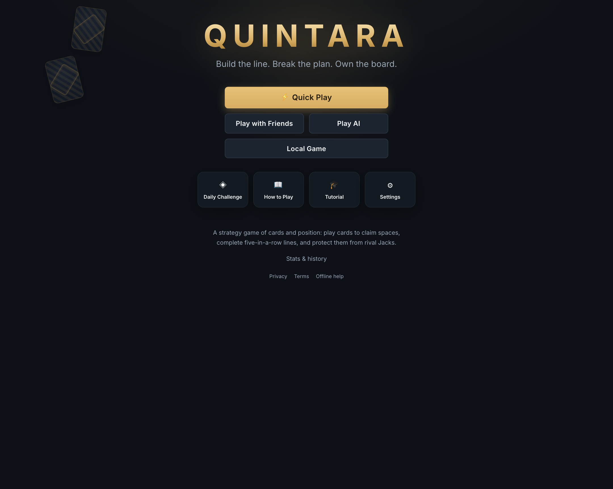
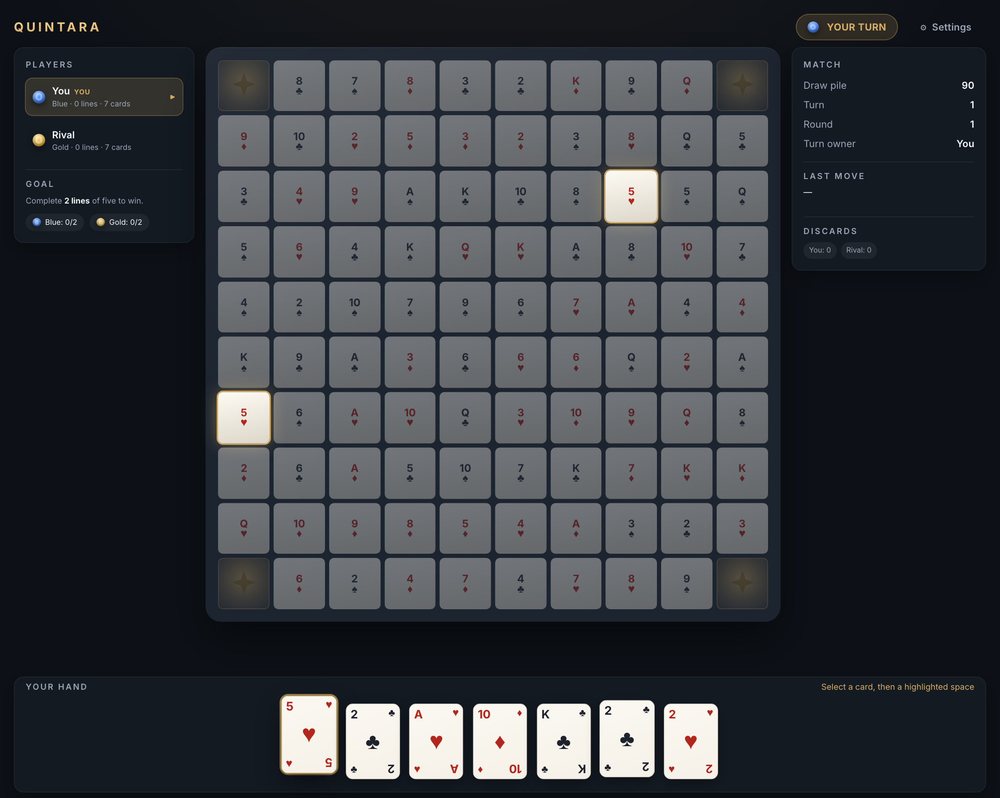
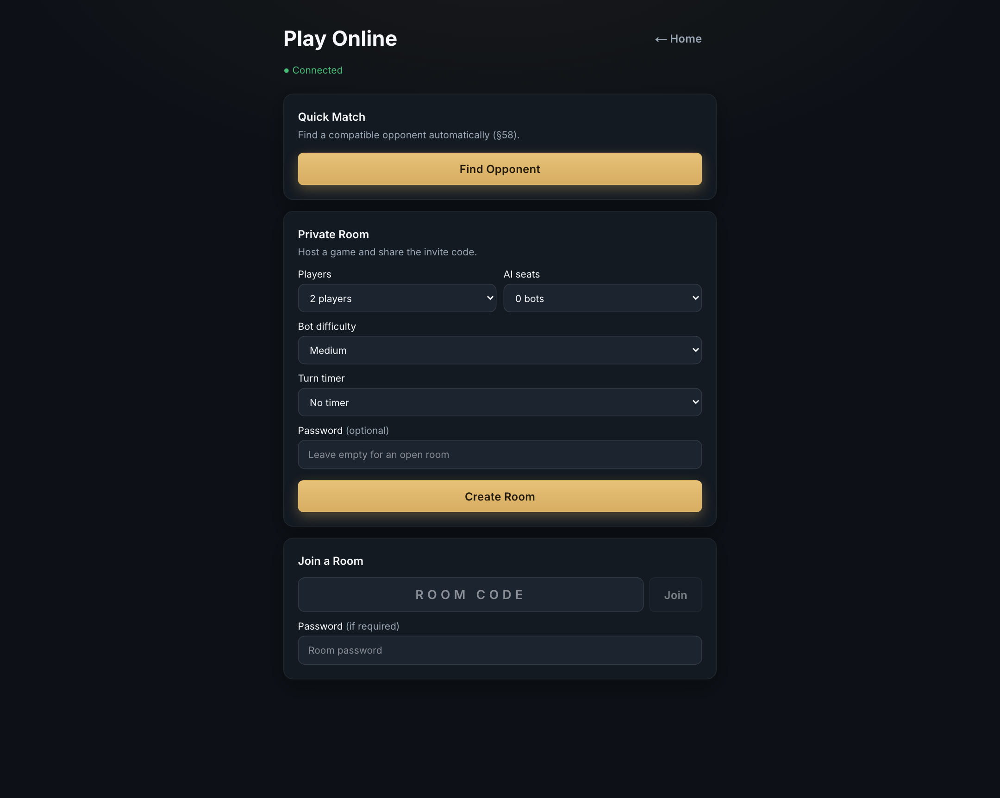

# QUINTARA

**Build the line. Break the plan. Own the board.**

[](https://github.com/vskrch/Quintara/actions/workflows/ci.yml)
[](https://vskrch.github.io/Quintara/)
[](https://nodejs.org/)
[](https://www.typescriptlang.org/)
[](#project-status)

Quintara is a browser-based strategy board game where cards meet position on a
10 × 10 board. Claim spaces, complete five-in-a-row lines, and protect them from
rival Jacks. Play solo against AI, pass-and-play on one device, or compete online
in private rooms and quick matches.

Quintara is an independent project. It is not affiliated with, endorsed by, or
sponsored by Jax Ltd., Goliath Games, Goliath IP Stichting, or the publishers of
the board game _Sequence_. See [Legal](#legal).

## Play now

<p align="center">
  <a href="https://vskrch.github.io/Quintara/">
    
  </a>
</p>

**The public demo is live at [vskrch.github.io/Quintara](https://vskrch.github.io/Quintara/)**,
hosted free on GitHub Pages. Solo vs AI, local pass-and-play, the tutorial, the
daily challenge, stats, and the installable offline PWA all work with no account
and no server.

| Capability                  | Public demo | Full online build |
| --------------------------- | :---------: | :---------------: |
| Solo vs AI                  |     ✅      |        ✅         |
| Local pass-and-play         |     ✅      |        ✅         |
| Tutorial & daily challenge  |     ✅      |        ✅         |
| Installable / offline PWA   |     ✅      |        ✅         |
| Private rooms & quick match |      —      | ✅ with a server  |
| Cost                        |     $0      | $0 on free tiers  |

The demo is rebuilt by [`.github/workflows/pages.yml`](.github/workflows/pages.yml)
on every push to `main`. Online rooms need the authoritative game server, which
GitHub Pages cannot run — see [Online multiplayer](#online-multiplayer) for the
free backend path.



## At a glance

| Property     | Details                                                                 |
| ------------ | ----------------------------------------------------------------------- |
| **Modes**    | Solo vs AI · local pass-and-play · online private rooms and quick match |
| **Players**  | 2, 3, 4, 6, 8, 9, 10, or 12 (mode-dependent)                            |
| **AI**       | Easy · Medium · Hard · Expert                                           |
| **Stack**    | TypeScript · Next.js 15 · Fastify · WebSocket · Vitest                  |
| **Platform** | Installable PWA for desktop and mobile browsers                         |
| **Play**     | [Live demo](https://vskrch.github.io/Quintara/) · free GitHub Pages     |
| **License**  | Proprietary — all rights reserved ([LICENSE](LICENSE))                  |

## Contents

- [Play now](#play-now)
- [Quick start](#quick-start)
- [Screenshots](#screenshots)
- [How to play](#how-to-play)
- [Features](#features)
- [Architecture](#architecture)
- [Documentation](#documentation)
- [npm scripts](#npm-scripts)
- [Testing and quality](#testing-and-quality)
- [Environment variables](#environment-variables)
- [Deployment](#deployment)
- [Online multiplayer](#online-multiplayer)
- [Security and privacy](#security-and-privacy)
- [Legal](#legal)
- [Project status](#project-status)
- [Troubleshooting](#troubleshooting)
- [Contributing](#contributing)
- [License](#license)

## Quick start

Requirements: **Node.js ≥ 20.11** and **npm ≥ 10**.

```bash
git clone https://github.com/vskrch/Quintara.git
cd Quintara
npm run dev
```

Open **http://localhost:3000**.

`npm run dev` installs dependencies and builds the shared packages on first run,
then starts both the web client and the authoritative game server. Press
**Ctrl+C** to stop both.

On macOS you can also double-click **`Start Quintara.command`** in Finder.

### Run the pieces separately

```bash
npm run dev:server   # game server on http://localhost:4000
npm run dev:web      # web client on http://localhost:3000
```

For online play with separate processes, create `apps/web/.env.local`:

```env
NEXT_PUBLIC_WS_URL=ws://localhost:4000/ws
NEXT_PUBLIC_SITE_URL=http://localhost:3000
```

The one-command launcher sets these defaults automatically. Without
`NEXT_PUBLIC_WS_URL`, the client derives the WebSocket URL from its own origin,
which is useful when both apps sit behind one domain.

## Screenshots

<p align="center">
  
  
</p>

## How to play

1. **Play a card.** Select a card from your hand, then claim a matching space on
   the board. A replacement card is drawn automatically.
2. **Build a line.** Five markers in a row — horizontal, vertical, or diagonal —
   completes a sequence.
3. **Protect your lines.** Completed sequences are permanent, and their markers
   cannot be removed by One-Eyed Jacks.
4. **Use the Jacks.** Two-Eyed Jacks (J♣ J♦) place a marker on any empty space;
   One-Eyed Jacks (J♥ J♠) remove an unprotected opponent marker.
5. **Win the race.** Two teams need two sequences; three or more teams need one.

The in-app **Rules** page has the full reference. The normative rules live in
`adr/game_engine_rules.md` (Rules Contract v1.0).

## Features

- **Deterministic rules engine** — pure TypeScript with no UI, network, or
  database dependencies. Same initial state, RNG stream, and ordered actions
  always produce the same final state, enabling byte-exact replays.
- **Four AI difficulties** — Easy, Medium, Hard, and Expert. Bots only use
  information legitimately available to their seat and never inspect hidden
  opponent hands or future deck order.
- **Solo, pass-and-play, and daily challenge** — fully client-side, with
  automatic save/resume, a fixed-seed Daily Challenge, and on-device stats.
- **Authoritative online multiplayer** — private rooms with invite codes and
  optional passwords, configurable turn timers, quick match, reconnect-safe
  sessions, idempotent actions, optimistic concurrency, and per-viewer state
  projection so opponent hands never cross the wire.
- **No account required** — guests receive a device-scoped signed identity, so
  a host can create a room and share an invite code immediately.
- **Server-authoritative turn clocks** — reconnecting or reloading resumes the
  existing deadline instead of granting a fresh turn.
- **PWA and offline play** — installable app shell, offline fallback page, and
  offline-capable solo/tutorial modes.
- **Accessible by design** — keyboard card selection and board focus, screen
  reader labels, reduced-motion support, focus-managed dialogs, and team markers
  that use colour, symbol, and pattern rather than colour alone.
- **Launch basics** — privacy/terms pages, branded error/offline pages,
  canonical URLs, sitemap/robots metadata, and a GitHub Actions verification
  workflow.

## Architecture

```
                ┌──────────────────┐
                │   Next.js PWA    │
                │  Board / UI / UX │
                └────────┬─────────┘
                         │  WebSocket / HTTPS
                ┌────────▼─────────┐
                │ Authoritative    │
                │  Game Server     │
                │ (Fastify + WS)   │
                └───────┬──────────┘
          ┌─────────────┼─────────────┐
 ┌────────▼────────┐    │     ┌───────▼────────┐
 │ Quintara Engine │    │     │  Game Store    │
 │ pure TypeScript │    │     │ (in-memory /   │
 │  (deterministic)│    │     │  pluggable)    │
 └─────────────────┘    │     └────────────────┘
                 ┌──────▼──────┐
                 │  AI package │
                 └─────────────┘
```

### Monorepo layout

```
/packages
  /game-engine    deterministic rules engine (Rules Contract v1.0)
  /game-ai        Easy/Medium/Hard/Expert bots
  /shared-types   client/server protocol types
  /config         board layout + immutable Standard presets
/apps
  /web            Next.js PWA (Tailwind v4, framer-motion, zustand)
  /server         Fastify + WebSocket authoritative game server
/docs
  /screenshots    README screenshots
/scripts          dev launcher, icon generation, WebSocket smoke test
```

The engine package must not import React, DOM, WebSocket, database, or CSS code.
This boundary is what makes local play, server validation, AI simulation, and
replay verification share the exact same rules.

### Documentation

- [`adr/game_engine_rules.md`](adr/game_engine_rules.md) — normative rules
  contract (v1.0)
- [`adr/Game_design_plan.md`](adr/Game_design_plan.md) — product and design
  specification
- [`docs/legal-risk-review.md`](docs/legal-risk-review.md) — IP, trademark,
  copyright, patent, and privacy risk review
- [`docs/ai-assistance-disclosure.md`](docs/ai-assistance-disclosure.md) —
  AI-assistance and human-authorship record
- [`docs/defense-playbook.md`](docs/defense-playbook.md) — lawyer-ready
  litigation and demand-letter response checklist
- [`docs/ip-asset-register.md`](docs/ip-asset-register.md) — asset provenance
  and ownership register
- [`docs/third-party-licenses.md`](docs/third-party-licenses.md) — dependency
  license inventory (local platform snapshot)
- [`/licenses`](apps/web/src/app/licenses/page.tsx) — in-app third-party
  notices and license texts
- [`.github/workflows/ci.yml`](.github/workflows/ci.yml) — CI pipeline
- [`docs/screenshots`](docs/screenshots) — screenshots used in this README

## npm scripts

| Command                  | What it does                                   |
| ------------------------ | ---------------------------------------------- |
| `npm run dev`            | Start the server and web client together       |
| `npm run dev:web`        | Start only the Next.js client                  |
| `npm run dev:server`     | Start only the game server                     |
| `npm run build:packages` | Build engine, AI, shared types, and config     |
| `npm run build`          | Production build for packages, server, and web |
| `npm test`               | Run all workspace test suites                  |
| `npm run typecheck`      | Strict TypeScript checks across the monorepo   |
| `npm run lint`           | ESLint                                         |
| `npm run start:server`   | Run the built server (`dist/index.js`)         |
| `npm run format`         | Format with Prettier                           |

## Testing and quality

```bash
npm test
npm run typecheck
npm run lint
npm run build
```

The suite currently contains **238 automated tests**: 192 engine, 40 server,
and 6 AI tests. CI (`.github/workflows/ci.yml`) runs install, package builds,
lint, typecheck, tests, and the production build on Node 20 and 22 for every
push to `main` and every pull request.

Run a single workspace suite with, for example:

```bash
npm test -w @quintara/game-engine
```

Engine coverage includes board/deck invariants, player configurations and
interleaved turn order, normal card play, Two-Eyed and One-Eyed Jacks, dead-card
exchange, sequence detection in all four directions, wild corners, long-run and
crossing overlap rules, the six-run ambiguous claim, the nine-run double line,
victory-before-draw, reshuffles, turn-skip and stalemate safeguards, viewer
privacy projections, and property-based random games (card conservation,
invariants, legal-action safety, atomic rejections).

Server tests cover wrong-turn rejection, identity binding, idempotent retries,
stale-version rejection, hand privacy over the wire, reconnect recovery, room
lifecycle, public/private history visibility, and replay redaction.

End-to-end transport check against a running server:

```bash
node scripts/ws-smoke.mjs ws://localhost:4000/ws
```

## Game rules summary

- 10 × 10 board: 96 card spaces (each identity appears twice) plus 4 universal
  wild corners.
- Two 52-card decks; Jacks are special:
  - **Two-Eyed (J♣ J♦)** — place a marker on any empty space.
  - **One-Eyed (J♥ J♠)** — remove an unprotected opponent marker.
- Play a card → claim a matching space → draw a replacement automatically.
- Complete **five in a row** horizontally, vertically, or diagonally to score a
  line. Completed lines are permanent and their markers are protected.
- Two competing sides need **2 lines**; three sides need **1**.
- One dead-card exchange per turn; deadness is evaluated dynamically.
- Same-team lines may share at most one space (crossing lines count twice).

The normative rules live in `adr/game_engine_rules.md` (Rules Contract v1.0).
Product and design specifications live in `adr/Game_design_plan.md`.

## Environment variables

### Server

| Variable               | Purpose                                                 | Default                 |
| ---------------------- | ------------------------------------------------------- | ----------------------- |
| `PORT`                 | HTTP/WebSocket port                                     | `4000`                  |
| `HOST`                 | Bind address                                            | `0.0.0.0`               |
| `CORS_ORIGIN`          | Comma-separated allowed origins, or `true` in dev       | `http://localhost:3000` |
| `QUINTARA_AUTH_SECRET` | HMAC secret for player tokens (≥32 chars in production) | ephemeral in dev        |
| `TRUST_PROXY`          | Trusted proxy hops or proxy IPs for client-IP limits    | unset (direct)          |

`QUINTARA_AUTH_SECRET` is mandatory when `NODE_ENV=production`. The server
refuses to boot without a real secret and rejects documented placeholder values.
A permissive CORS setting (`CORS_ORIGIN=true`) should only be used locally.

Set `TRUST_PROXY` when the server runs behind the reverse proxy described below
so per-IP rate limits see real client addresses. Leave it unset when the server
is directly exposed.

### Web

| Variable                    | Purpose                                                                                                                                                                                                              |
| --------------------------- | -------------------------------------------------------------------------------------------------------------------------------------------------------------------------------------------------------------------- |
| `NEXT_PUBLIC_WS_URL`        | WebSocket endpoint, e.g. `wss://game.example.com/ws`                                                                                                                                                                 |
| `NEXT_PUBLIC_SITE_URL`      | Canonical site URL used by metadata and the sitemap. Must be a domain you own in production.                                                                                                                         |
| `NEXT_PUBLIC_CONTACT_EMAIL` | Public contact address on the privacy and terms pages. Required for production deployments. The build fails fast when a production deployment is detected (Vercel production or a non-local `NEXT_PUBLIC_SITE_URL`). |
| `NEXT_PUBLIC_BASE_PATH`     | Subpath prefix for static hosting, e.g. `/Quintara`. Leave unset at a domain root.                                                                                                                                   |
| `NEXT_PUBLIC_DEMO_MODE`     | Set to `1` for a frontend-only build; the online lobby explains that a game server is required.                                                                                                                      |
| `NEXT_STATIC_EXPORT`        | Build-time flag. Set to `1` to enable `output: "export"` and trailing-slash routes for GitHub Pages or another static host.                                                                                          |

Copy `.env.example` to the relevant location as a starting point.

## Deployment

### Public demo — GitHub Pages (free)

The live demo is **<https://vskrch.github.io/Quintara/>**. It is a static export
of `apps/web`, built by [`.github/workflows/pages.yml`](.github/workflows/pages.yml)
on every push to `main`. There is no server, database, container, card, or paid
plan behind it.

What the workflow does:

- builds the shared packages, then runs `next build` with `NEXT_STATIC_EXPORT=1`;
- sets `NEXT_PUBLIC_BASE_PATH` from the repository name, so the same workflow
  works for forks served at `https://<owner>.github.io/<repo>/`;
- sets `NEXT_PUBLIC_SITE_URL` to the Pages origin for canonical URLs;
- sets `NEXT_PUBLIC_DEMO_MODE=1` when no game server is configured, so the
  online lobby explains the limitation instead of waiting forever;
- publishes `apps/web/out` through GitHub's official Pages actions.

To show a real contact address on the hosted privacy and terms pages, add the
repository **Actions variable** `NEXT_PUBLIC_CONTACT_EMAIL`. Without it the
static demo uses the public GitHub issue tracker as its contact channel.

### Online multiplayer

GitHub Pages is static, so private rooms and quick match need the Fastify
WebSocket server. The Render free tier is the zero-cost path:
[`render.yaml`](render.yaml) provisions one free web service with a generated
`QUINTARA_AUTH_SECRET`, a health check, proxy trust, and CORS for the Pages demo.

<p align="center">
  <a href="https://render.com/deploy?repo=https://github.com/vskrch/Quintara">
    
  </a>
</p>

After the service is live:

1. Copy its URL, for example `https://quintara-server.onrender.com`.
2. In GitHub → **Settings → Secrets and variables → Actions → Variables**, add
   `NEXT_PUBLIC_WS_URL` with the value `wss://quintara-server.onrender.com/ws`
   and, because production builds require a monitored contact channel,
   `NEXT_PUBLIC_CONTACT_EMAIL` with a real mailbox.
3. Re-run **Deploy demo to GitHub Pages** from the Actions tab (or push to
   `main`). The next build enables online play and removes the demo notice.

Render's free instance sleeps after about 15 minutes of inactivity, and the
first connection after a nap can take up to a minute to wake it. The server
uses the in-memory store, so active rooms and history reset when it restarts.
That is perfect for a friends-and-family beta; use a persistent `GameStore`
before a ranked or paid launch.

### Self-host the full stack

```bash
npm ci
npm run build
npm run start:server
npm run start -w @quintara/web
```

### Hosting notes

- **Web**: deploy the Next.js app to any Node host (Vercel, Fly.io, Render,
  etc.). The service worker provides the offline shell. For a static host,
  build with `NEXT_STATIC_EXPORT=1` and configure `NEXT_PUBLIC_BASE_PATH` when
  the app is not served from the domain root.
- **Server**: deploy the Fastify process to a Node host (Fly.io, Railway,
  Render, AWS, GCP). Put it behind TLS and a reverse proxy that forwards
  WebSocket upgrades.
- **Persistence**: the default store is in-memory and single-instance. Implement
  the `GameStore` interface in `apps/server/src/store.ts` against PostgreSQL or
  Redis before running multiple instances or relying on durable history.
- **Secrets**: set a random `QUINTARA_AUTH_SECRET` of at least 32 characters.
  Generate one with `openssl rand -base64 48`.
- **Configuration**: set `CORS_ORIGIN`, `NEXT_PUBLIC_WS_URL`,
  `NEXT_PUBLIC_SITE_URL`, `NEXT_PUBLIC_CONTACT_EMAIL`, and `TRUST_PROXY` for
  the target environment. `NEXT_PUBLIC_SITE_URL` must be a domain you own;
  the app resolves it as `NEXT_PUBLIC_SITE_URL` → Vercel production URL →
  Vercel deployment URL → localhost, and never defaults to an unowned domain.
  `NEXT_PUBLIC_CONTACT_EMAIL` is required in production; the app fails fast
  rather than publishing a privacy policy without a monitored contact. Set both
  variables together: an unset `NEXT_PUBLIC_SITE_URL` is treated as a local
  build, so do not rely on the guard alone.
- **Shutdown**: the server handles `SIGTERM`/`SIGINT` gracefully.
- Before a paid launch, have the privacy/terms pages reviewed by counsel and
  set a monitored contact address.

## Security and privacy

- The server is authoritative. Clients send intents; every command is validated,
  version-checked, idempotent, and broadcast as a per-viewer projection.
- Opponent hands, draw-pile order, and RNG state never cross the wire. Public
  replays expose a spectator projection only.
- Public history lists public-room results only. Private-room summaries remain
  replayable by their unguessable game ID for participants, but their player
  names are not published in the shared history feed.
- Active room state is discarded when a room closes. Finished games are retained
  in the in-memory store (currently up to 500 games and 200 summaries) until the
  server restarts or older records are evicted.
- Guest identity tokens are device-scoped and signed with
  `QUINTARA_AUTH_SECRET`. There are no accounts or password-based logins yet.
- HTTP rate limits are per-process. Multi-instance deployments should add
  gateway- or Redis-backed limits.

To report a security issue, please use GitHub's [private security advisory
flow](https://github.com/vskrch/Quintara/security/advisories/new) rather than
opening a public issue. See [`SECURITY.md`](SECURITY.md) for scope, the
good-faith no-action statement, and response expectations.

## Legal

Quintara is **proprietary software**. The repository is publicly viewable for
portfolio and evaluation purposes, but it is not open source. No license is
granted for reuse, redistribution, or derivative works except as stated in
[`LICENSE`](LICENSE).

- **Copyright** — © 2026 Venkata Sai Krishna Chirasani, to the extent copyright
  and other rights subsist and are owned. All rights reserved.
- **AI assistance** — the project used substantial AI assistance while human
  creative direction, selection, editing, integration, testing, and review were
  predominant. See
  [`docs/ai-assistance-disclosure.md`](docs/ai-assistance-disclosure.md).
- **Trademarks** — QUINTARA and the Quintara lattice logo are used as
  unregistered common-law marks by the project owner. No registered trademark
  is claimed. See [`TRADEMARK.md`](TRADEMARK.md) for status, including an
  adverse US Class 9 registration owned by Brilliant Systems LLC. Use **™**,
  not **®**, unless a registration issues.
- **Non-affiliation** — Quintara is an independent project. It is not
  affiliated with, endorsed by, or sponsored by Jax Ltd., Goliath Games, Goliath
  IP Stichting, or the publishers of the board game _Sequence_. _Sequence_ is a
  registered trademark of Goliath IP Stichting; Jax Ltd., Inc. was the original
  registrant.
- **Third-party components** — dependencies and fonts remain under their own
  licenses. See [`THIRD_PARTY_NOTICES.md`](THIRD_PARTY_NOTICES.md),
  [`docs/third-party-licenses.md`](docs/third-party-licenses.md), and the
  in-app [`/licenses`](apps/web/src/app/licenses/page.tsx) page.
- **Contributions** — by submitting a pull request or patch, you agree to the
  contribution terms in [`CONTRIBUTING.md`](CONTRIBUTING.md).
- **Risk review and defense file** — the practical IP review, open questions,
  and launch checklist are in
  [`docs/legal-risk-review.md`](docs/legal-risk-review.md). The
  litigation-response checklist is in
  [`docs/defense-playbook.md`](docs/defense-playbook.md).

This section is not legal advice. Before a commercial launch, obtain a formal
trademark clearance search, copyright registrations, and a patent
freedom-to-operate review from qualified counsel in your target markets.

## Project status

Quintara is a **playable beta**. Solo, pass-and-play, tutorial, daily challenge,
private online rooms, and quick match are implemented and covered by automated
tests. It is suitable for a private beta or friends-and-family deployment on a
single server instance.

Known limitations before a mass-market competitive launch:

- In-memory persistence: a server restart ends active online matches and loses
  process-local history/replays.
- No accounts, ranked seasons, leaderboards, or skill-based matchmaking.
- No replay viewer UI, although the replay API and storage model exist.
- Three-player Standard games use a three-team layout and are more draw-prone
  than two-team configurations. In a 200-game HARD-bot simulation, 30.5% ended
  in a stalemate. The UI warns about this rather than hiding the valid
  configuration.
- AI difficulty tiers are heuristic, not tournament-calibrated. Treat Expert as
  a strong local opponent, not a ranked benchmark.
- Password hashing uses synchronous `scrypt`; move to async hashing or a worker
  pool before high-concurrency deployments.

### Roadmap

- Durable PostgreSQL/Redis `GameStore` adapter and replay archive
- Accounts, ranked play, seasons, and leaderboards
- Replay browser and shareable match pages
- Async password hashing and distributed rate limiting
- Load testing, observability, and multi-region deployment
- A 3-player variant or house rule that reduces stalemates

## Troubleshooting

### Ports 3000 or 4000 are already in use

`npm run dev` starts both services. Stop the process holding the port, then
retry:

```bash
lsof -i :3000
lsof -i :4000
```

### The online lobby stays disconnected

The web client must be able to reach the game server. Check that the server is
running on port 4000, and that `NEXT_PUBLIC_WS_URL` points at its WebSocket
endpoint (for example `ws://localhost:4000/ws`). The one-command launcher sets
this automatically.

### `npm run typecheck` fails on a fresh clone

The workspace packages must be compiled before other packages can resolve their
types:

```bash
npm run build:packages
npm run typecheck
```

`npm run build` and `npm run dev` do this for you.

### macOS blocks `Start Quintara.command`

Right-click the file in Finder and choose **Open**, or allow it under
**System Settings → Privacy & Security**.

### The production server refuses to start

Set `QUINTARA_AUTH_SECRET` to a random value of at least 32 characters:

```bash
export QUINTARA_AUTH_SECRET="$(openssl rand -base64 48)"
```

The server rejects documented placeholder secrets in production.

## Contributing

Issues and pull requests are welcome, subject to the contribution terms in
[`CONTRIBUTING.md`](CONTRIBUTING.md). In short: the project is proprietary, and
by submitting a contribution you grant the project owner a broad, irrevocable
license to use it. Before opening a PR:

```bash
npm ci
npm run build:packages
npm test
npm run typecheck
npm run lint
npm run build
```

Keep the engine pure: no React, DOM, network, database, or CSS imports in
`packages/game-engine`. New rules behavior should include deterministic tests,
and multiplayer changes should include a privacy/idempotency check where
relevant.

## License

Quintara is **proprietary** and **not open source**. The repository is publicly
viewable for portfolio and evaluation purposes, but no license is granted for
reuse, redistribution, hosting, or derivative works except as stated in
[`LICENSE`](LICENSE). The root `package.json` uses `"license": "UNLICENSED"`.

Third-party components remain under their own licenses; see
[`THIRD_PARTY_NOTICES.md`](THIRD_PARTY_NOTICES.md). The QUINTARA name and logo
are trademarks of the project owner; see [`TRADEMARK.md`](TRADEMARK.md).
